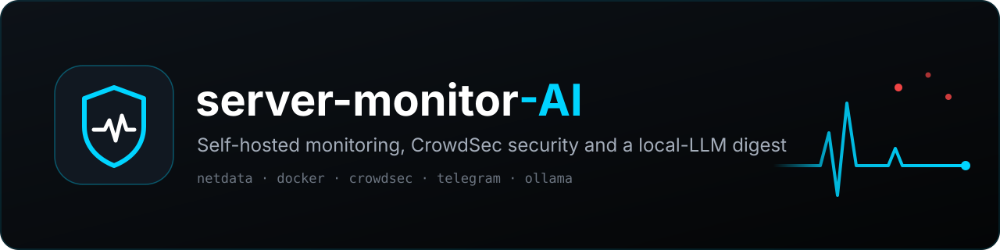
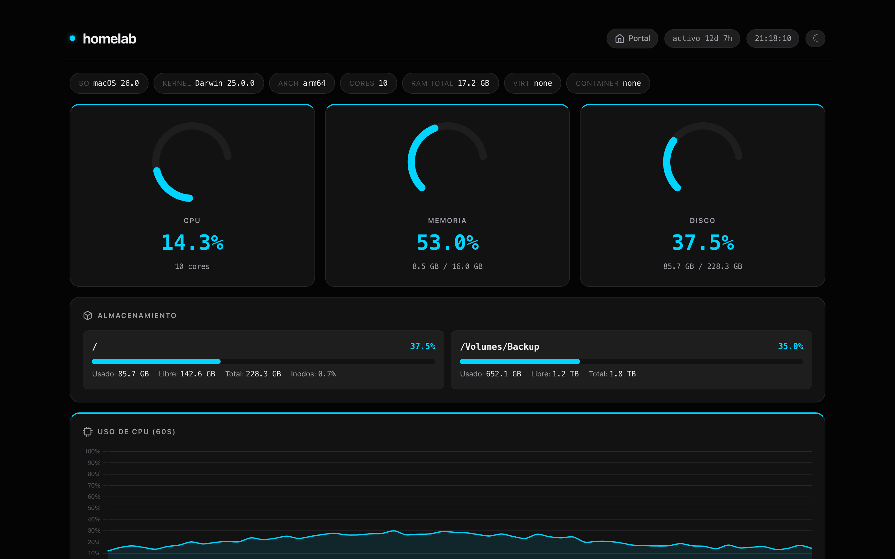
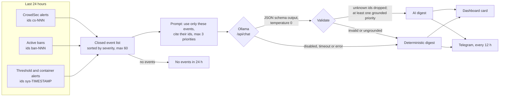
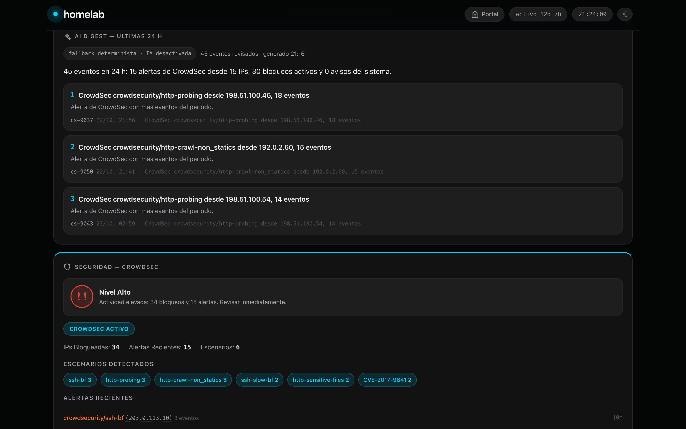
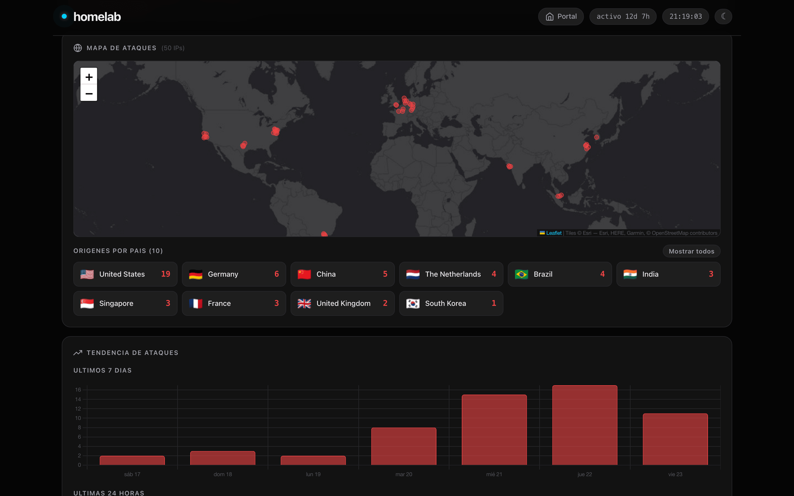
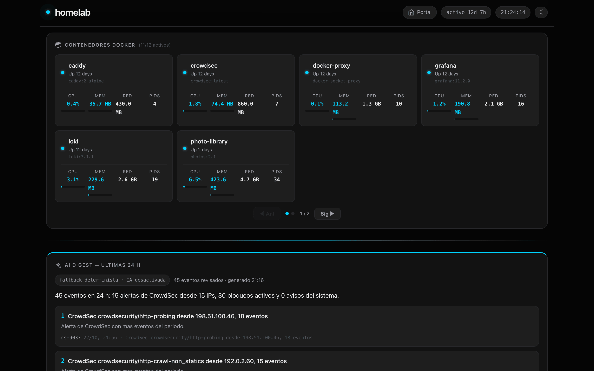
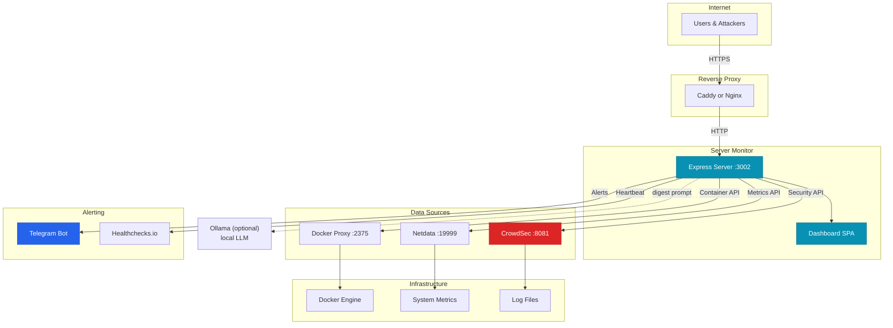
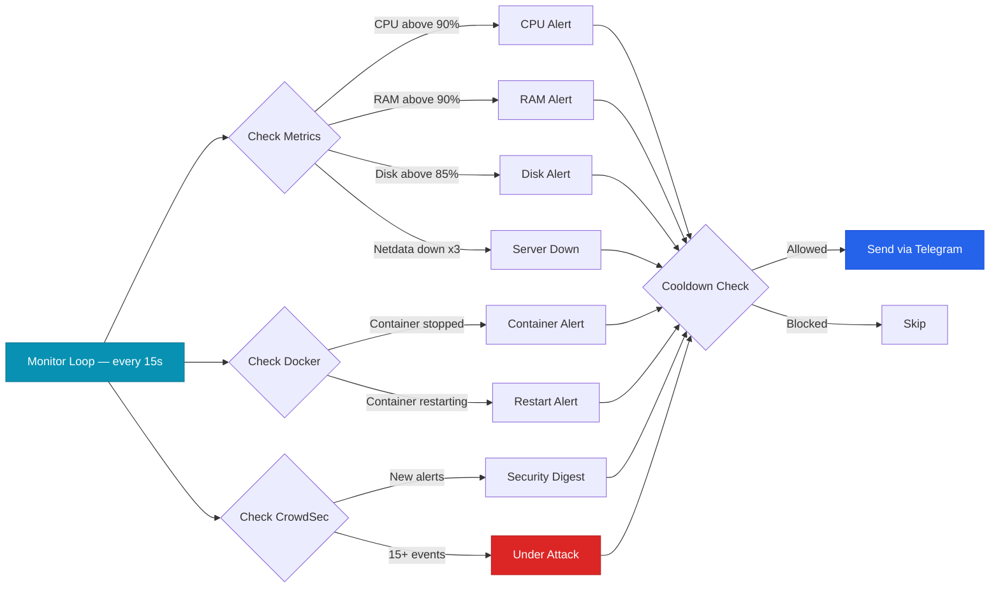
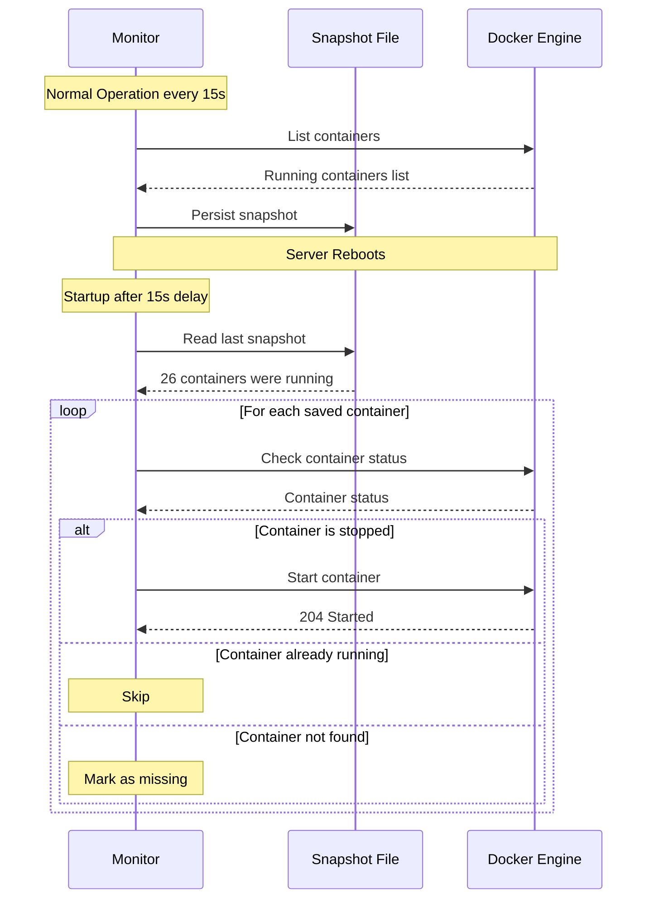
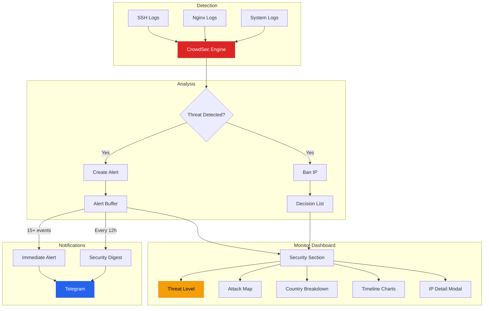

<p align="center">
  
</p>

<p align="center">
  
  
  
  
  
  
  
  
</p>

<p align="center"><b>One dashboard for a self-hosted server: live metrics, Docker containers, CrowdSec security with an attack map, Telegram alerts, automatic recovery after a reboot, and a daily security digest written by a local LLM.</b></p>

A single Node.js process with one dependency (Express) and a vanilla JS frontend. It reads Netdata, the Docker Engine API through a read-only socket proxy and the CrowdSec LAPI, and it runs behind a reverse proxy with SSO headers or Basic Auth.



## What is AI here, and what is not

| Part | How it works | AI? |
|---|---|---|
| Metrics and threshold alerts | Netdata values against fixed thresholds (CPU and RAM above 90% for two consecutive checks, disk above 85%), with per-type cooldowns | No, deterministic |
| Container alerts and auto-recovery | State diff between polls; a snapshot of running containers is restored after a reboot | No, deterministic |
| Threat detection and bans | Delegated to CrowdSec: behaviour scenarios over SSH, web and system logs, plus its community blocklist | No machine learning; CrowdSec's own rules |
| Attack map and statistics | Aggregation and IP geolocation | No |
| **Security digest** | A local model in Ollama summarises the last 24 hours of events and ranks the three things to look at first | **Yes, and it only summarises** |

The LLM never blocks an IP, restarts a container or changes configuration. It receives a closed list of events and returns text; everything it says must point at those events.

### How the AI digest stays grounded



- **Closed input.** Every event gets a stable id (`cs-9037`, `ban-17`, `sys-1729690000000`) and the prompt contains only that list.
- **Constrained output.** Ollama is called with a JSON schema (`summary`, up to three `priorities` with `event_ids`) at temperature 0.
- **Validation, not trust.** Ids that are not in the input are removed; a priority left without ids is discarded, and an answer whose priorities are all ungrounded is rejected.
- **Always an answer.** Without `OLLAMA_URL`, on timeout (`OLLAMA_TIMEOUT_MS`), on HTTP errors or invalid output, the deterministic digest is shown instead, and the card says which one you are looking at and why.
- **Tested offline.** `npm test` runs the validation and every fallback path against a fake Ollama.

<p align="center"></p>

<sub>The card in this screenshot runs without Ollama, so the digest falls back to the deterministic version and says so in its label.</sub>

## Screenshots

<table>
  <tr>
    <td width="50%"><br><sub><b>Security</b>: attack map, origin countries and the 7-day and 24-hour attack trend.</sub></td>
    <td width="50%"><br><sub><b>Containers</b>: live status and per-container CPU, memory, network and PIDs.</sub></td>
  </tr>
</table>

<sub>Screenshots come from the real server and dashboard running locally against a demo upstream (synthetic Netdata, Docker and CrowdSec responses; attacker IPs use the RFC 5737 documentation ranges). The interface is in Spanish; 1440x900, dark theme.</sub>

---

## Architecture



---

## Alert Flow



---

## Container Auto-Recovery



---

## Security Pipeline



---

## Key engineering decisions

- **One process, one dependency.** Express serves the API and the static dashboard; HTTP calls use Node's own `http`, `https` and `fetch`. Nothing to build, small attack surface.
- **Read-only Docker access.** The Docker API is reached through a socket proxy that exposes only what the dashboard needs, never the raw socket.
- **Deterministic alerting with hysteresis.** Two consecutive readings for CPU and RAM, three failures before "server down", and per-type cooldowns keep Telegram quiet unless something is really wrong.
- **Security events are buffered.** CrowdSec alerts are collected into a 12-hour digest instead of one message each; only a burst of 15+ alerts triggers an immediate "under attack" message.
- **The LLM is optional and boxed in.** It summarises a closed list of events, its output is schema-checked and cross-checked against the input, and every failure mode has a deterministic fallback. See [How the AI digest stays grounded](#how-the-ai-digest-stays-grounded).
- **Recovery that survives reboots.** The list of running containers is persisted continuously and replayed on start, compose-project aware, with retries.
- **Auth that fits a homelab.** Behind a proxy it trusts `X-Auth-*` headers from the SSO and rejects proxied requests without them; direct access falls back to Basic Auth. Write actions require an admin role.

---

## Features

### System Monitoring
- **CPU** -- Real-time usage with 60-second history chart, per-core breakdown
- **Memory** -- Active/wired/compressed/inactive/free breakdown with visual bar
- **Disk** -- All mount points with usage, I/O rates, and inode stats
- **Swap** -- Usage tracking with visual indicator
- **Network** -- Per-interface traffic (RX/TX) with 60-second history
- **Load Average** -- 1m/5m/15m with progress bars relative to core count
- **Processes** -- Top 15 by CPU/memory usage
- **TCP/UDP Connections** -- IPv4 and IPv6 socket stats

### Docker Container Management
- Live container list with status indicators (running/paused/stopped)
- Per-container stats: CPU%, memory, network I/O, PIDs
- Detailed container modal with ports, env vars, restart policy
- Paginated grid view for large deployments

### Automatic Service Recovery
- Periodically snapshots the list of running containers
- On boot, automatically restarts containers that were running before a server restart
- Manual snapshot and restore via dashboard buttons
- Compose-project-aware: tracks which services belong to which stack

### Security (CrowdSec Integration)
- **Threat Level Indicator** -- Low/Medium/High based on active alerts and bans
- **Alert Feed** -- Recent CrowdSec alerts with scenario names and source IPs
- **Banned IPs** -- Active decisions (bans) with duration
- **Attack Map** -- Interactive Leaflet map with IP geolocation
- **Country Breakdown** -- Origin countries sorted by threat count with flags
- **Attack Timeline** -- Daily (7 days) and hourly (24h) bar charts
- **Scenario Analysis** -- Top attack scenarios with frequency bars
- **IP Detail Modal** -- Click any IP for full info: ISP, org, AS, coordinates, related alerts, ban history

### Alerting (Telegram)
- Real-time alerts via Telegram bot with configurable cooldowns
- **Security Digest** -- 12-hour summary; written by the local LLM when Ollama is configured and validated, otherwise the deterministic summary of top scenarios and banned IPs
- **AI digest card** -- the same digest on the dashboard, with the evidence behind each priority and whether it came from the model or the fallback
- **Healthchecks.io** -- Heartbeat every 60 seconds for uptime monitoring
- Test button in dashboard to verify Telegram connectivity

### UI/UX
- Dark and light theme with system preference detection
- Responsive design (mobile, tablet, desktop)
- Apple-style glassmorphism header with backdrop blur
- SVG gauge indicators for CPU/RAM/Disk
- Real-time clock and uptime display
- Password-protected dashboard (Basic Auth or proxy auth headers)

---

## Quick Start

### 1. Clone the repository

```bash
git clone https://github.com/diegoperezg7/server-monitor-AI.git
cd server-monitor-AI
```

### 2. Install Netdata on the host

```bash
bash <(curl -Ss https://my-netdata.io/kickstart.sh)

# Verify
curl http://localhost:19999/api/v1/info
```

### 3. Set up Docker Socket Proxy

```bash
docker network create docker_proxy

docker run -d \
  --name docker-proxy \
  --restart unless-stopped \
  -e CONTAINERS=1 \
  -e INFO=1 \
  -e NETWORKS=0 \
  -e VOLUMES=0 \
  -e IMAGES=0 \
  -e POST=1 \
  -v /var/run/docker.sock:/var/run/docker.sock:ro \
  --network docker_proxy \
  tecnativa/docker-socket-proxy
```

### 4. Set up CrowdSec

```bash
docker volume create crowdsec-config
docker volume create crowdsec-data

cd crowdsec
docker compose up -d

# Register the monitor as a machine
docker exec crowdsec cscli machines add dashboard-monitor --password YOUR_PASSWORD

# Create a bouncer API key (save the output)
docker exec crowdsec cscli bouncers add monitor-bouncer
```

### 5. Configure and launch

```bash
cd ..
cp .env.example .env
# Edit .env with your credentials

docker compose up -d --build
```

Dashboard available at `http://localhost:3002`

### 6. (Optional) Logging stack

```bash
cd logging
docker compose up -d
```

- **Grafana** at `http://localhost:3030`
- **Loki** at `http://localhost:3101`
- Promtail auto-discovers Docker containers

---

### 7. (Optional) AI digest with Ollama

```bash
ollama pull qwen2.5:7b
# in .env
OLLAMA_URL=http://host.docker.internal:11434
OLLAMA_MODEL=qwen2.5:7b
```

Without `OLLAMA_URL` the dashboard and Telegram use the deterministic digest.

### Tests

```bash
npm install
npm test
```

## Configuration

### Environment Variables

| Variable | Description | Default |
|----------|-------------|---------|
| `NETDATA_URL` | Netdata API base URL | `http://127.0.0.1:19999` |
| `CROWDSEC_URL` | CrowdSec LAPI URL | `http://127.0.0.1:8081` |
| `CROWDSEC_MACHINE_ID` | CrowdSec machine identifier | `localhost` |
| `CROWDSEC_PASSWORD` | CrowdSec machine password | - |
| `CROWDSEC_BOUNCER_KEY` | CrowdSec bouncer API key | - |
| `NET_INTERFACE` | Network interface to monitor | `en1` |
| `TELEGRAM_BOT_TOKEN` | Telegram bot token from @BotFather | - |
| `TELEGRAM_CHAT_ID` | Telegram chat ID for alerts | - |
| `HEALTHCHECK_PING_URL` | Healthchecks.io ping URL | - |
| `DASHBOARD_URL` | Dashboard URL (included in alerts) | - |
| `DASHBOARD_PASSWORD` | Basic Auth password for direct access (any username) | - |
| `DOCKER_HOST` | Docker API endpoint | socket |
| `AUTO_RESTORE_ON_BOOT` | Auto-restore containers on start | `true` |
| `RESTORE_STATE_FILE` | Path to container state file | `data/active-services-state.json` |
| `RESTORE_STARTUP_DELAY_MS` | Delay before auto-restore | `15000` |
| `RESTORE_SYNC_INTERVAL_MS` | Snapshot sync interval | `15000` |
| `OLLAMA_URL` | Ollama base URL; enables the AI digest | - |
| `OLLAMA_MODEL` | Model used for the digest | `qwen2.5:7b` |
| `OLLAMA_TIMEOUT_MS` | Timeout before falling back to the deterministic digest | `20000` |
| `AI_DIGEST_TTL_MS` | How long a digest is reused by the dashboard | `900000` (15min) |
| `RATE_WINDOW_MS` | Rate limit window | `60000` |
| `RATE_MAX_REQUESTS` | Max requests per window | `240` |
| `RATE_BAN_MS` | Temporary ban duration | `900000` (15min) |
| `RATE_LIMIT_BYPASS_IPS` | Comma-separated IPs to bypass rate limit | - |

### Alert Cooldowns

| Alert Type | Cooldown | Trigger Condition |
|------------|----------|-------------------|
| CPU High | 5 min | Above 90% for 2 consecutive checks |
| RAM High | 5 min | Above 90% for 2 consecutive checks |
| Disk High | 15 min | Above 85% |
| Server Down | 1 min | Netdata unreachable 3x |
| Container Down | 2 min | Container stopped |
| Container Restart | 2 min | Container in restart loop |

### Reverse Proxy (Caddy)

```
monitor.yourdomain.com {
    reverse_proxy localhost:3002
}
```

### Reverse Proxy (Nginx)

```nginx
server {
    server_name monitor.yourdomain.com;

    location / {
        proxy_pass http://127.0.0.1:3002;
        proxy_set_header Host $host;
        proxy_set_header X-Real-IP $remote_addr;
        proxy_set_header X-Forwarded-For $proxy_add_x_forwarded_for;
        proxy_set_header X-Forwarded-Proto $scheme;
    }
}
```

---

## API Endpoints

All endpoints require authentication (Basic Auth or proxy headers).

| Method | Endpoint | Description |
|--------|----------|-------------|
| GET | `/api/system` | CPU, RAM, disk, load, uptime, I/O, network |
| GET | `/api/storage` | All disk mount points with I/O and inodes |
| GET | `/api/swap` | Swap memory usage |
| GET | `/api/cpu-cores` | Per-core CPU usage |
| GET | `/api/cpu-history` | 60-point CPU history |
| GET | `/api/net-history` | 60-point network history |
| GET | `/api/io-history` | 60-point disk I/O history |
| GET | `/api/connections` | TCP/UDP connection stats |
| GET | `/api/disk-io` | Disk I/O per device |
| GET | `/api/processes` | Top 15 processes by CPU/memory |
| GET | `/api/network-interfaces` | Network interface details |
| GET | `/api/docker` | Docker container list |
| GET | `/api/docker-stats` | All container stats summary |
| GET | `/api/docker/:id/stats` | Individual container detailed stats |
| GET | `/api/restore-state` | Container restore state and snapshot |
| POST | `/api/restore-state/snapshot` | Force snapshot of running containers |
| POST | `/api/restore-state/restore` | Manually restore containers from snapshot |
| GET | `/api/security` | CrowdSec health, alerts, decisions |
| GET | `/api/security-geo` | Security data with IP geolocation and map |
| GET | `/api/ip-info/:ip` | IP geolocation and attack history |
| GET | `/api/attack-stats` | Attack timeline (daily/hourly) and scenarios |
| GET | `/api/ai-digest` | Latest security digest (AI or deterministic), cached |
| POST | `/api/ai-digest/refresh` | Regenerate the digest now (admin) |
| GET | `/api/alerts/status` | Alert configuration and history |
| POST | `/api/alerts/test` | Send test Telegram alert |
| GET | `/api/info` | Netdata host info |
| GET | `/api/alarms` | Active Netdata alarms |
| GET | `/api/logs` | System event log |
| GET | `/api/system-info` | Extended system info (OS, kernel, arch) |

---

## Security

- Password-protected dashboard (Basic Auth)
- Proxy auth headers (`X-Auth-User`, `X-Auth-Email`, `X-Auth-Role`) for SSO
- Rate limiting: 240 req/min per IP, 15-min ban on excess
- Security headers: `X-Content-Type-Options`, `X-Frame-Options`, `X-XSS-Protection`
- Docker access via read-only socket proxy (no direct socket mount)
- CrowdSec JWT tokens cached with auto-refresh
- IP geolocation cached 24h, private IPs excluded
- Container env vars filter out PATH/HOME/HOSTNAME

---

## Project structure

```
server-monitor-AI/
  server.js                    # Express backend: API, monitoring loops, alerts, recovery
  ai-digest.js                 # Event list, prompt, validation and fallback for the AI digest
  test/
    ai-digest.test.js          # node:test suite with a fake Ollama
  public/
    index.html                 # Single-page dashboard (HTML + CSS + JS)
  docs/                        # Banner and screenshots
  docker-compose.yml           # Monitor container
  Dockerfile                   # Node.js Alpine image
  .env.example                 # Configuration template
  crowdsec/
    docker-compose.yml         # CrowdSec container
  logging/
    docker-compose.yml         # Loki + Promtail + Grafana stack
    loki-config.yml
    promtail-config.yml
  data/
    .gitkeep                   # Runtime state (container snapshot)
```

## Tech stack

- **Backend**: Node.js 20 + Express 4, no other runtime dependency
- **Frontend**: vanilla HTML, CSS and JS, no build step
- **Charts and maps**: Chart.js and Leaflet (CDN), Esri gray canvas tiles
- **Data sources**: Netdata API, Docker Engine API via socket proxy, CrowdSec LAPI, ip-api.com
- **AI**: Ollama (local), called with native `fetch`
- **Alerts**: Telegram Bot API, Healthchecks.io heartbeat
- **Logging**: Loki + Promtail + Grafana

## License

Copyright (c) 2024-2026 Diego Pérez. All rights reserved.

Published for portfolio and evaluation purposes only. You may read the code to evaluate the author's work; copying, modifying, distributing or using it requires written permission. See [LICENSE](LICENSE).
